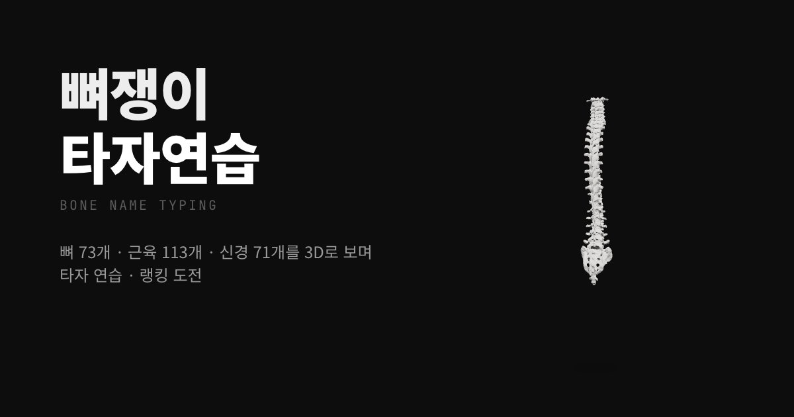

# 🦴 뼈쟁이 타자연습 · Bone Name Typing

**정형외과 전공의가 Claude Code와 만든 뼈 · 근육 · 신경 이름 타자연습 게임**

👉 **플레이: https://bone-typing.vercel.app**
📸 만든 사람: [@iamnotwoodz](https://www.instagram.com/iamnotwoodz/) — 「킹받는 뼈쟁이 프로그램」 시리즈 원조



## 어떤 게임인가요

- 뼈 · 근육 · 신경 이름을 치면 그 구조물의 **3D 모델**이 날아와 가운데서 돌아가요
- 우리말 · 옛 한자어 용어 · 영어, 낱말 연습과 문장 연습(신경 지배 · 작용 · 손상 증상 등 1,300문장+)
- 쳐야 할 글자가 흐리게 깔리고 그 위를 따라 쳐요. 틀리면 빨갛게 흔들려요
- 모형 키보드가 다음에 칠 키를 알려줘요 (두벌식 자모 표기)
- 전국 랭킹 — 점수 = 타수 × 정확도²

## 가져다 쓰셔도 돼요 🙌

코드는 MIT 라이선스예요. 고쳐서 새 게임을 만들어도, 다른 과 버전을 만들어도 좋아요.
**한 가지 부탁:** 화면 아래 `made by @iamnotwoodz` 크레딧은 남겨 주세요. 원조를 따라와 주는 게 저한테는 제일 큰 도움이에요.

## 실행

```bash
npm install
npm run dev
```

### 랭킹 켜기 (Supabase, 선택)

1. Supabase 프로젝트에서 `supabase/migrations/` 를 순서대로 실행
2. `.env.local` 에
   ```
   VITE_SUPABASE_URL=https://<ref>.supabase.co
   VITE_SUPABASE_ANON_KEY=<anon key>
   ```
   설정이 없으면 랭킹은 이 브라우저에만 저장돼요.

## 구조

| 파일 | 내용 |
|---|---|
| `src/data/bones.ts` · `muscles.ts` · `nerves.ts` | 뼈 · 근육 · 신경: 옛 용어 · 영어 · 3D 노드 |
| `src/data/sentences.ts` | 문장 연습 |
| `src/lib/typing.ts` | 한글 자모 분해 비교(es-hangul), 다음 키 계산 |
| `src/components/BoneStage.tsx` | three.js 무대: 날아오기 · 회전 · 맞힘 파티클 |
| `src/components/Keyboard.tsx` | 모형 키보드 |
| `src/lib/ranking.ts` · `supabase/` · `api/` | 랭킹 · 공유 링크 썸네일 |
| `public/models/` | 3D 모델 (`CREDITS.md`) |

## 라이선스

- 코드와 게임 데이터: [MIT](LICENSE) © 2026 iamnotwoodz
- 3D 모델(`public/models/`): BodyParts3D © DBCLS, CC BY-SA 2.1 JP · Z-Anatomy, CC BY-SA 4.0 — 원래 라이선스를 따라요

※ 공부용으로 단순화한 내용이 있어요. 의학적 판단의 근거로 쓰지 마세요.

---

### English

**Bone Name Typing** — a typing game for bone, muscle and nerve names with 3D models, made by an orthopedic resident with Claude Code.
Play at **https://bone-typing.vercel.app** · by [@iamnotwoodz](https://www.instagram.com/iamnotwoodz/).
MIT licensed — fork it freely, just please keep the `made by @iamnotwoodz` credit on screen. 3D models keep their CC BY-SA licenses.
